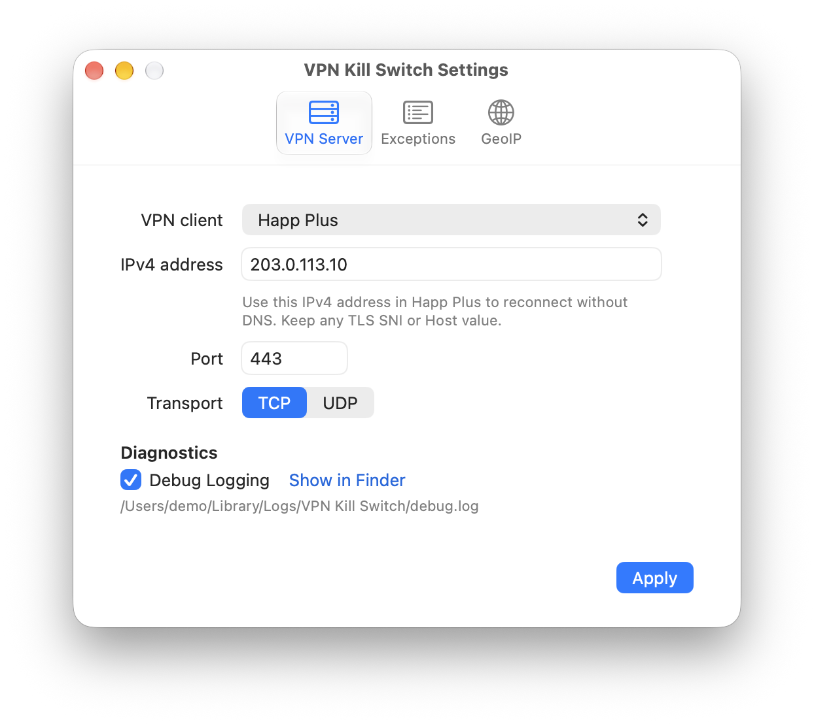
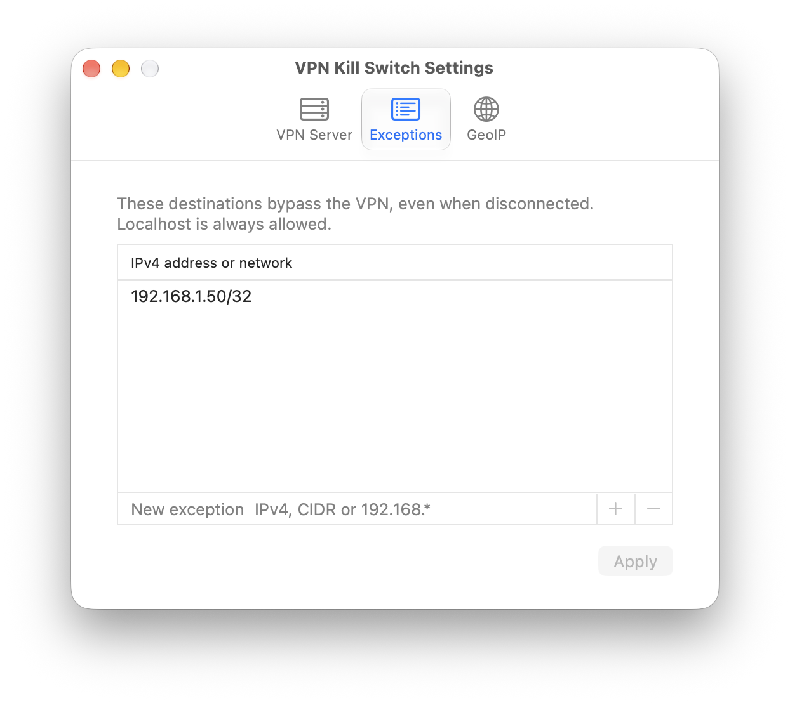

# VPN Kill Switch for macOS

If Shadowrocket or Happ Plus disconnects, VPN Kill Switch blocks ordinary internet traffic so your Mac won’t silently switch to a direct connection. You can still reach the VPN server to reconnect and any destinations you explicitly allow, such as a printer on your home network.

## Install

1. On an **Apple Silicon Mac running macOS 13 or later**, open the [latest GitHub release](https://github.com/ivan1911/vpn-kill-switch/releases/latest) and download the file ending in **`-arm64.dmg`** under **Assets**.
2. Open the DMG, drag **VPN Kill Switch** to **Applications**, then eject the disk image.
3. Launch **VPN Kill Switch** from Applications. Its controls are in the macOS menu bar. Approve the administrator prompt to let it read the firewall status.

The release uses an ad hoc signature. If macOS says it cannot verify the developer, check that you downloaded the app from this repository and review [Apple’s first-launch instructions](https://support.apple.com/en-us/102445). For Intel Macs, see [building the universal app](docs/technical-reference.md#source-and-build).

## Set up your VPN

1. Open the server profile you use in **Shadowrocket** or **Happ Plus**. Find the VPN server’s **IPv4 address, port and transport** (TCP or UDP). If the profile uses a hostname, get the numeric IPv4 address from your provider and use it in the client too. Keep the original TLS SNI or Host value.
2. In the VPN Kill Switch menu, open **Settings… → VPN Server**. Choose your client, enter those same values and click **Apply**. The screenshot shows an example server.
3. In Shadowrocket, set **Global Routing → Proxy**. Connect your chosen VPN client, open the VPN Kill Switch menu and choose **Install Kill Switch…**. Approve the prompt. When the menu reads **Protection: On**, traffic can use the VPN tunnel.

<picture>
  <source media="(prefers-color-scheme: dark)" srcset="docs/screenshots/vpn-server-dark.png">
  
</picture>

## Use the menu bar

| What the menu says | What it means |
| --- | --- |
| **Protection: On** | The firewall allows the selected VPN tunnel. |
| **Protection: Internet blocked** | The firewall is waiting for the VPN. Reconnect your client to get back online. |
| **Protection: Direct exceptions only** | The VPN tunnel is unavailable. Your saved exceptions can still use the network directly. |
| **Protection: Off** | The kill switch is disabled. Your Mac can connect directly. |

Open **Protection** to see the selected client, its connection state and your external IPv4 address. Click the address to copy it. To display its country flag, open **Settings → GeoIP** and click **Download Database**.

### Allow a printer or another local device

Open **Settings → Exceptions**, type the device’s IPv4 address and click **+**, then **Apply**. For example, adding `192.168.1.50` lets that one device bypass the VPN. Add a network only if you want every address in it to bypass the VPN, including while disconnected. To revoke access, select the entry, click **−**, then **Apply**.

<picture>
  <source media="(prefers-color-scheme: dark)" srcset="docs/screenshots/exceptions-dark.png">
  
</picture>

## Turn off protection or uninstall

Choose **Remove Kill Switch…** from the menu and approve the prompt. This works offline and keeps your server settings for next time. **Quitting the app leaves protection active**, including after a restart. To uninstall the app, remove the kill switch first, then quit the app and move it from Applications to the Trash.

If you’re offline and cannot open the app, run this in Terminal on the affected Mac to remove protection and restore direct access:

```sh
sudo /Library/PrivilegedHelperTools/local.shadowrocket-killswitch/remove
```

For logs, additional recovery options and build instructions, see the [technical reference](docs/technical-reference.md).
