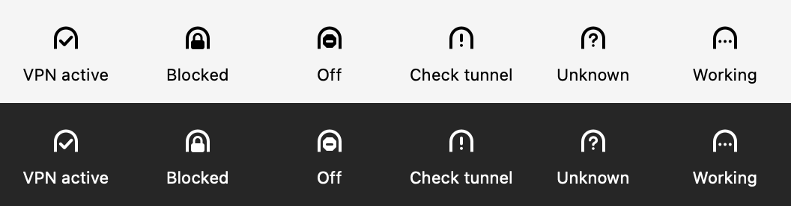

# VPN Kill Switch technical reference

The menu bar shows whether the Mac blocks internet traffic outside the selected VPN client and which tunnel is allowed. A system service manages the macOS packet filter (`pf`) and keeps protection active when you quit the app. The service runs independently of the Homebrew `killswitch` utility.

[User guide](../README.md) · [HTML guide](../index.html)

## Get started

On a Mac running macOS 13 or later, [download the Universal DMG from GitHub Releases](https://github.com/ivan1911/vpn-kill-switch/releases/latest). Open it, drag **VPN Kill Switch** to **Applications**, eject the disk image and launch the app from Applications. The app uses an ad hoc signature and is not notarized. Smaller single-architecture builds are available for Apple Silicon (arm64) and Intel (x86_64).

1. In **Settings → VPN Server**, choose **Shadowrocket** or **Happ Plus**. On a new Mac the app preselects the sole installed client. If both are installed, choose one. Existing installations open with Shadowrocket and their applied VPN server.
2. Enter the selected server’s numeric IPv4 address, port and transport (TCP or UDP), then click **Apply**. Use the same numeric address in the VPN client so it can reconnect while direct DNS is blocked. Keep the original TLS SNI or Host value. In Shadowrocket, select **Global Routing → Proxy**. Connect the selected VPN client. Authorize VPN Kill Switch to read the firewall rules. Click the menu bar icon. A stop sign inside the arch means protection is off. A closed padlock means protection is on and the VPN is disconnected. The **Protection** row names the state and shows a green dot when the tunnel is allowed, orange when internet access is blocked or limited to direct exceptions, red when attention is needed, and gray when protection is off or its status is unknown. While an operation is in progress, the row shows **Protection: Working…**. Open its submenu to see the VPN client, its connection state and the external IPv4 address. Hold Option in the submenu to show the allowed tunnel and last check time.
3. When protection is off, choose **Install Kill Switch…**. When protection is on, the same menu item becomes **Remove Kill Switch…**, even if the VPN is disconnected. The item is hidden while protection status is unknown. **Settings…** opens the **VPN Server** pane. **About** opens a separate window with the build identifier and an **Open Guide** link. In Settings, use **⌘1**, **⌘2** or **⌘3** to switch panes.

Opening Protection checks the public IPv4 seen by ifconfig.co and internet-lab.ru over the current route. External RU IPv4 appears only when both checks succeed and the Russian site sees a different address. Click either address to copy the IPv4 as plain text. Each flag comes from the local GeoIP database for the displayed address. While the submenu is open, checks run at most once a minute. A blocked connection shows “Blocked”. If the service cannot be reached, the row shows “Unavailable”.

In Settings → GeoIP, click Download Database to add a country flag beside the external IPv4. The default source is Loyalsoldier’s V2Ray geoip.dat. You can enter another HTTPS URL for a compatible database. Hover over the flag for the country name and code. Without a match, the row shows just the IP. The database card shows the installed file size, source URL and last successful update in local time. Click Update Installed Database to fetch from the source shown on the card. Download Database fetches from the URL in the field each time, including when the installed database uses the same URL. Updates are manual, and a failed update keeps the previous database.

Install and connect the selected client before enabling protection for the first time. Removal works offline even if the client is unavailable. It keeps the applied VPN client, server IPv4, port and transport. To enable protection again, connect that client and choose **Install Kill Switch…**.

The installer checks HTTPS before and after activation. It requests Apple’s connectivity test page over the selected tunnel. Initial activation clears existing connection states. If a reinstall fails, the installer attempts to restore the previous rules, VPN server and service. If rollback fails, it prints the backup path.

To update the menu bar app, quit it and reopen the new build. An existing service continues protecting Shadowrocket. The first protected Apply upgrades a legacy service under the same authorization. To reinstall from Terminal, use the newly packaged installer with the selected client connected.

## Direct IPv4 exceptions

Open **Settings → Exceptions** to manage destinations that can use Wi-Fi or Ethernet even when the VPN is disconnected. Localhost, `127.0.0.1` and `::1` already work.

1. Enter an IPv4 address, aligned CIDR network or trailing wildcard in the field below the table. Click **+** to its right, or press Return in the field. For example, `192.168.*` appears as `192.168.0.0/16`. An individual address appears with `/32`.
2. Click a row to edit its address in place. Return accepts the edit and Escape restores the value from the start of the edit. To delete entries, select one or more rows and click **−**. If the saved list changed during editing, **Reload** discards the draft and reads the latest list. If macOS requires authorization to read it, choose **Read with Administrator Access…**.
3. Click **Apply** and authorize the change. An installed service updates immediately, including while the VPN is disconnected. With protection off, the app saves the list for the next installation. Removing all rows and clicking **Apply** clears the custom exceptions.

Public addresses grant direct access on all ports. Applying a list containing `0.0.0.0/0` asks you to confirm **Allow All IPv4** because the exception allows all IPv4 traffic outside the VPN. If a destination has a conflicting route, the app reports a failed Apply and restores the previous list. Revoking an active exception clears PF connection states.

Existing 1.8.0 exceptions appear in the tab automatically. The first successful edit saves them as system preferences and upgrades an older installed service under the same authorization. With protection on and the VPN disconnected, the checker lists the direct destinations and reports `Allowed tunnel: none`.

## VPN configuration

| Setting | Value |
| --- | --- |
| VPN client | Shadowrocket or Happ Plus |
| Shadowrocket routing | Global Routing → Proxy |
| Server address and port | Set in **Settings… → VPN Server** |
| VPN profile | Detected locally by the selected client’s provider identifier |
| launchd service | `local.shadowrocket-killswitch` |
| Firewall anchors | `local.shadowrocket-guard` and `local.shadowrocket-guard/tunnel` |

Settings remembers the IPv4 address, port and transport as you edit them, separately for Shadowrocket and Happ Plus. These local values survive closing the window, relaunching the app and removing protection. Opening **Settings → VPN Server** and editing a different client leaves the current connection active until **Apply**. Apply changes the client and its server together. With protection enabled, switching to a disconnected client blocks ordinary internet traffic until the selected tunnel connects. You can correct the VPN server offline. The VPN server rule matches traffic by server IPv4, port and transport. If that exact socket also serves DNS, it is reachable through the same VPN server rule.

Connect the selected client once to create its VPN profile. The service needs exactly one enabled profile for that client. To see the available profiles, run `scutil --nc list`.

## How protection works

- **At startup**, macOS loads `/etc/pf.conf`. The installer adds a reference to `/etc/pf.anchors/local.shadowrocket-guard`. A LaunchDaemon enables pf and checks the allowed tunnel against the selected VPN profile about every five seconds.
- **If firewall rules change**, the service checks that the guard is the first filter rule and restores the base rules from the saved policy if needed. After a repair it clears old connection states. If clearing fails, it retries on the next service run.
- **Without a VPN**, the base rules allow loopback on `lo0`, IPv4 DHCP broadcasts and replies, and the configured VPN server. Configured direct IPv4 destinations are also allowed. Remaining traffic is blocked.
- **With a VPN**, the service allows the active profile’s `utun` interface. Its number can change after reconnecting or restarting. The service clears the tunnel rule when the VPN disconnects. If only the remote proxy fails, the VPN client can still report `Connected`.
- **In the menu bar**, the app reads a firewall status sample every 30 seconds and shows the check time as `HH:mm` while Option is held in the Protection submenu. Connecting or disconnecting the selected VPN profile wakes the authorized monitor immediately. If the tunnel rule is still changing, it checks again at three-second intervals, up to three times. During reconnection, when the connection row says `Connected` and the Option diagnostics say `Allowed tunnel: none`, macOS has a VPN interface and PF has yet to allow it. The menu shows **Protection: On** once the checker confirms that the two interfaces match. Installing or removing protection and applying a VPN server change from the app trigger an immediate firewall check under the same authorization. The menu displays the result as soon as the check finishes, including after a failed operation. A stale result shows **Status unknown**. Quitting the app stops the monitor.



## Diagnose an installation attempt

Every build enables debug logging on first launch (`build.sh` sets `VPNKillSwitchDebugDefault`). Reproduce the issue once, click **Show in Finder** beside **Debug Logging**, and look at the timestamps in `~/Library/Logs/VPN Kill Switch/debug.log`. To copy the path, select it under **Debug Logging** and press Command-C. The journal records actions inside VPN Kill Switch, authorization outcomes and installer checks. It keeps the current file and one rotated file (`debug.log.1`), each approximately 1 MiB. To stop recording, turn off **Debug Logging** in **Settings → VPN Server → Diagnostics**. The choice persists after relaunch.

## Commands and recovery

| Command | Project file | Action |
| --- | --- | --- |
| `vpn-ks-check` | [Status checker](../Commands/check-shadowrocket-killswitch.command) | Inspect live rules and compare tunnel interfaces |
| `vpn-ks-install` | [Installer](../Commands/install-shadowrocket-killswitch.command) | Install the service and enable protection |
| `vpn-ks-remove` | [Uninstaller](../Commands/remove-shadowrocket-killswitch.command) | Remove the service and restore direct access |

For a fresh command-line installation, supply the VPN server as three arguments, for example `vpn-ks-install IPV4 PORT tcp`. For UDP, use `udp` as the last argument. After configuration, `vpn-ks-install` reuses the saved values. Each file in `Commands/` runs on its own from Finder or with `/bin/sh`. To install or update the commands in `~/.local/bin`:

```sh
mkdir -p "$HOME/.local/bin"
for action in check install remove; do
    install -m 700 "Commands/$action-shadowrocket-killswitch.command" "$HOME/.local/bin/vpn-ks-$action"
done
```

If the selected VPN client is connected but the internet is unreachable, run `vpn-ks-check`. If the interfaces differ, wait five seconds and check again. Exit code `0` means protection is on and the tunnel matches the profile. Code `1` means protection is off. Code `2` means the checker could not verify a consistent state.

```sh
scutil --nc list
scutil --nc status "Happ Plus"    # or Shadowrocket
sudo pfctl -si | head -1
sudo pfctl -sr
sudo pfctl -a local.shadowrocket-guard -sr
sudo pfctl -a local.shadowrocket-guard/tunnel -sr
launchctl print system/local.shadowrocket-killswitch
lsof -nP -a -c MacPacket -iTCP
```

With the VPN disconnected and protection active, the command prints `Protection: on.` and `Allowed tunnel: none`. The menu shows **Internet blocked** with an empty direct list, or **Direct exceptions only** when destinations are configured. With a matching connected tunnel, the top-level row shows **Protection: On** and the command reports the allowed `utun`.

With protection active, look for `Status: Enabled`, a reference to the guard anchor and a final `block drop quick all` in that anchor. The tunnel anchor allows the active `utun` while connected and is empty while disconnected. Between scheduled runs, launchd can report `state = not running`. Check `runs` and `last exit code` for the last result.

**To remove protection offline**, run this in a local Terminal:

```sh
sudo /Library/PrivilegedHelperTools/local.shadowrocket-killswitch/remove
```

If the installed helper is unavailable, run `/bin/sh Commands/remove-shadowrocket-killswitch.command` from the project root. Removal allows direct internet access without the VPN.

## Source and build

For the full regression suite, component map and DMG verification procedure, see the [agent build guide](agents/build-and-verify.md).

| Location | Contents |
| --- | --- |
| `main.swift`, `Status.swift` | AppKit menu and status decoding |
| `Admin.swift` | Authorization and status monitoring |
| `MenuGlyph.swift`, `Assets/` | Menu bar icons, app icon and previews |
| `Guard/` | Service, pf rules, LaunchDaemon and installer with rollback |
| `Commands/` | Standalone scripts. The checker compares the live exception with the saved address, port and transport. |
| `Scripts/` | Relative links to the commands embedded in the app |
| `Tools/package-commands.py` | Packages the standalone checker, installer and uninstaller |
| `Tests/`, `Tools/IconPreview/` | Tests, monitor harness and icon preview generator |
| `build/VPN Kill Switch.app` | Built app with ICNS icon |

About shows the build identifier. Development builds use the current version and source commit, for example `0.1.0-dev+g0123456`. A release shows the version and the resulting commit of its release PR.

Package a development build from the project root with `./build-dmg.sh` (requires Xcode Command Line Tools with Swift and Python 3). The image is written to `build/`. To run the development build, open `build/VPN Kill Switch.app`. Edit `Guard/` for the standalone commands and service. Run `./build.sh` to regenerate and embed the commands, build the icon and verify the signature. For standalone commands only, run `python3 Tools/package-commands.py`.

Run the status tests without administrator privileges or network changes:

```sh
mkdir -p build
xcrun swiftc Status.swift Tests/Status/main.swift -o build/status-test
./build/status-test
```
